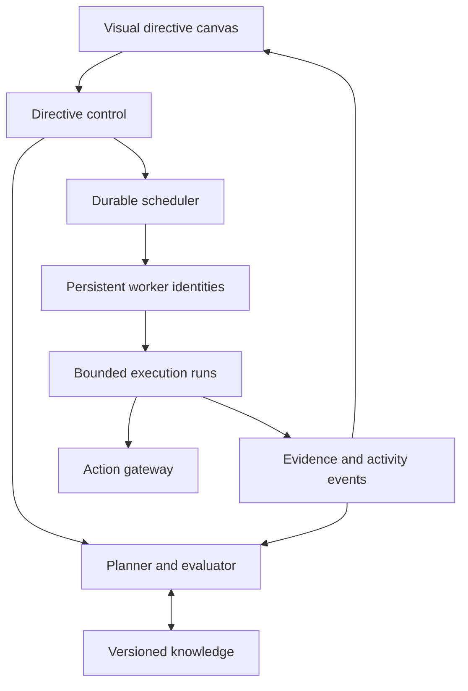
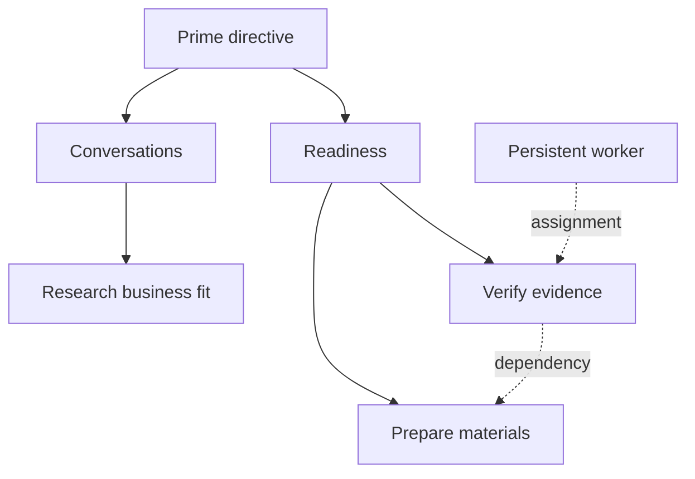

# The Prime Directive

## Technical architecture and development plan

Prepared for Phillip Galinsky | 24 October 2026 | Specification version 2.0 — visual workforce revision

Build an objective management system that turns a user's documents, desired outcome, constraints, and authority into a continuously managed program of work. The system proposes strategies, creates materials, coordinates specialist agents, conducts authorized outreach, records responses, and revises its plan when evidence changes. A user manages the directive and its exceptions rather than supervising every model call.

The Prime Directive is the product name, a reference to Star Trek and a description of its human interface. Its principal investment is a durable control system around reasoning agents: shared knowledge with provenance, explicit plans, controlled external actions, and evidence of outcomes. The product can organize very large numbers of logical agents and tasks, but compute, money, provider quotas, recipient attention, and human decisions remain finite. Neither complete understanding nor success in an external objective can be guaranteed by adding more agents.

The recommended first release is a bounded private alpha for commercial partnership and investor workflow management, accompanied by public civic information and voluntary participation tools. The complete roadmap contains 92 development units with dependencies, acceptance conditions, and negative tests. Work-unit IDs describe scope; actual PRs, implementation, acceptance and deployment are recorded separately. See [verified implementation status](IMPLEMENTATION_STATUS.md) for the delivered local reference and remaining work.

## 1 Product model and scope

The central object is the prime directive. It specifies a desired external state, the evidence needed to establish that state, an owner, a deadline or review horizon, resource limits, and the actions the system may take. Each prime directive contains subdirectives, alternative strategies, dependencies, artifacts, relationships, and experiments. Subdirectives can decompose further into microtasks with explicit inputs, outputs, costs, and completion checks. The system creates and manages that hierarchy itself. The owner does not need to write a project plan. One user may run several directives that share approved knowledge and contacts without sharing every permission or confidential fact.

Death of the Salesman, as described in the product brief, concentrates on selling a defined offering through a comparatively established acquisition process. The Prime Directive must choose and revise the process itself. For example, a company may need to resolve a positioning question, assemble a diligence room, identify relevant firms, establish conversations, answer technical questions, and organize meetings before financing becomes possible. Tasks should exist because they advance an explicit subgoal, resolve an uncertainty, or satisfy an operational obligation.

| Dimension | The Prime Directive design |
| --- | --- |
| Primary input | Outcome, evidence, constraints, source documents, existing relationships |
| Planning | Several candidate strategies with assumptions, costs, dependencies, and exit conditions |
| Execution | Bounded tasks carried out by specialist workers under an explicit mandate |
| Learning | Evidence updates the world model and proposed plan; successful dispatch is not success |
| User control | Approve direction and authority once; review meaningful exceptions and changes |
| Scale | Many stored tasks and agent identities; bounded concurrent execution |
| Completion | An independent outcome check supports completion, failure, or inconclusive status |

The product supports commercial outreach based on documented professional relevance, general public communications, opt-in community administration, and neutral procedural assistance. Civic and political work supports factual explanations adapted for language, reading level, and technical vocabulary, answers to submitted questions, public educational materials, broadly available statements and petitions, voluntary coalition administration, official status monitoring, and factual procedural correspondence. It excludes automated personalized political persuasion directed at specific people or demographic groups, political susceptibility scoring, inferred ideology, manufactured endorsements, and concealed coordinated identities. A commercial matching workflow must not become a route around those restrictions by relabeling a political directive.

Fundraising support covers preparation, research, authorized introductions, diligence logistics, and recording progress. Agents cannot bind the owner to financing terms, represent themselves as licensed intermediaries, accept funds, or invent financial representations. The action catalog distinguishes administrative support from regulated or binding transactions. Channel and jurisdiction requirements are configured per approved use; a global product does not imply global permission to send.

## 2 User experience and the operating cycle

The first session asks the user to describe the outcome, add documents, select an owner identity, set budget and timing, and choose a level of autonomy. The assistant extracts a proposed charter from the prime directive and documents, applies the owner's standing settings, and displays only unresolved choices that materially affect authority or the meaning of success. Missing dates, budgets, or success criteria remain visible assumptions until accepted. Research and drafting can proceed while external execution remains disabled.

The user sees five primary areas: prime directive overview, subdirectives and work, knowledge and materials, relationships and conversations, and decisions. The main action is Give a prime directive. A document upload and standing preferences supply the rest of the initial brief. The overview reports verified progress, next milestones, spending and reservations, active work, blocked work, and changes requiring attention. The primary interface is a visual directive graph with the prime directive at the top or left, expandable nested subdirectives and tasks, and moving, selectable worker nodes. Clicking a work item opens its progress, evidence and dependencies. Hovering or selecting a worker opens its current activity summary and persistent specialty profile. A text tree remains an accessible alternative. See VISUAL_WORKFORCE.md for the interaction and persistence contracts.

The operating cycle is explicit. First the system checks the charter and source coverage. It then compares candidate strategies and proposes a plan. Within a standing mandate, the system activates a valid plan version automatically. A review-first setting is available, but reviewing every plan or subdirective is not the default operating requirement. The scheduler releases eligible tasks, workers return structured results, reviewers check evidence, and the action gateway commits authorized external effects. Outcomes and replies update the directive record. Replanning occurs at milestones, material changes, or scheduled reviews, with limits on how much work each review may create.

One click pauses a directive, and a tenant-wide stop suspends all new external dispatch. The interface distinguishes queued actions, actions currently being submitted, and actions already accepted by an external service. A sent message cannot be recalled by changing a database flag. The user can inspect the exact plan and mandate in effect for every action.

| User decision | System preparation | What happens afterward |
| --- | --- | --- |
| Give the prime directive | Outcome definition derived from the instruction and documents | System develops and manages the directive hierarchy |
| Set standing authority | Budget envelope, action classes, contact scope, and exceptions | Subdirectives and routine actions proceed within those limits |
| Resolve an exception | Concrete draft or action, cause, consequences, alternatives | Only the affected work resumes |
| Change direction | Proposed plan version and treatment of pending actions | Obsolete work is cancelled or reconciled |
| Close the directive | Outcome evidence, unresolved obligations, retention choices | New execution stops; necessary obligations remain tracked |

## 3 Relationship to the existing platforms

Place reusable execution capabilities in Superintelligence Engine and expose the directive experience through Superintelligence Command Center. Keep The Prime Directive's domain logic in a distinct package so it can also have a dedicated product interface. Reuse canonical workspace, user, project, and artifact identifiers wherever the engine already owns them. An integration adapter must never establish a second independently writable copy of the same directive authority or project identity.

| Platform | Proposed responsibility | Integration boundary |
| --- | --- | --- |
| Superintelligence Engine | Shared identity, artifact services, model access, execution primitives where suitable | Versioned capability contracts and canonical identifiers |
| Superintelligence Command Center | Operator interface and entry point for directive work | Directive views over the same backend records |
| Boardroom | Software development assignments and repository coordination | Development work items and acceptance evidence; no production message dispatch |
| Engine Room | Portfolio progress and service health reporting | Canonical work registry plus live repository and deployment evidence |
| Death of the Salesman | Defined commercial sales playbooks | Optional task provider through the same permission and contact controls |
| Academy | Training and reusable instructional content | Optional approved learning artifacts; no execution authority |

The initial contract audit is recorded in docs/INTEGRATION_AUDIT.md and the ownership map is represented in src/domain/ownership.ts. Live adapter integration remains separately gated. Existing implementations are reused when their behavior meets the required contract. Missing pieces are added behind adapters. The canonical registry is registry/prs.json, mapped to the inspected Boardroom contract. Original work IDs retain a legacyId field; PD001 maps to PD-001 and likewise through PD080. No historical units were dropped or double-counted. Counts must be derived from stable work IDs and live evidence, never inferred from arbitrary pull request totals.

## 4 Logical architecture

The system separates planning from authority. A language model may propose a plan, draft content, or request a tool call. Deterministic services decide whether that call is permitted, whether its inputs remain current, and how its result is committed. No planner, reviewer, or specialist worker receives unrestricted service credentials.



The control plane owns directives, plans, budgets, approvals, scheduling policy, and stop controls. The knowledge plane owns source versions, claims, retrieval, context compilation, and relationships. The execution plane runs isolated workers and durable workflows. The integration plane owns authenticated external calls and reconciles external results. Observability and audit records connect the planes through directive, task, run, and action identifiers.

Start with a modular backend and a small number of deployable processes: operator web application, API, durable workflow workers, isolated parsing and generation workers, and connector workers. These are security and scaling boundaries. They do not require a separate network service for every agent role. Split additional services only when independent load, residency, failure isolation, or team ownership justifies them.

| Component | Recommended baseline | Reason and tradeoff |
| --- | --- | --- |
| Operator application | React and TypeScript, within the existing Command Center conventions | Accessible interactive views with shared contracts |
| Application API | TypeScript modular service; reuse the engine's framework | Keeps domain transactions and authorization in one codebase initially |
| Durable orchestration | Temporal with TypeScript workers, behind an execution adapter | Timers, retries, pauses, and recovery for work lasting days or months |
| Transactional store | PostgreSQL on the selected managed provider, including Neon if retained | Relational constraints, transactions, isolation, and operational familiarity |
| Search | PostgreSQL full-text search plus pgvector and explicit reranking | Supports exact terms and semantic retrieval without another primary database |
| Source and asset storage | S3-compatible private object storage | Immutable source objects and large artifacts outside workflow histories |
| Cache and rate counters | Redis-compatible cache only when measured need appears | Useful acceleration; never the sole authority for spend or permission |
| Policy enforcement | Typed, versioned policy rules with automated fixtures | Deterministic authorization; a later policy engine can replace the adapter |
| Telemetry | OpenTelemetry-compatible traces, metrics, and structured events | Correlates model calls, workflow activity, and external outcomes |
| Secrets | Managed secret store and short-lived scoped credentials | Keeps access tokens outside model context and artifacts |

Temporal documents durable execution and recovery through workflow history [S1]. External side effects still require application-level idempotency because activities can be retried [S2]. This specification therefore uses an action ledger and outbox rather than treating workflow durability as a universal exactly-once guarantee. Managed versus self-hosted Temporal is an operational and cost decision for the foundation spike; the engine adapter is the stable application contract.

## 5 Directive charter and measurable goals

The charter contains directive ID, tenant and workspace IDs, owner and delegates, domain, objective statement, desired outcome predicates, deadline and time zone, baseline, minimum acceptable outcome, evidence sources, budget, action permissions, prohibited actions, known relationships, confidentiality, and review cadence. It also records critical dependencies and obligations that survive directive closure, such as scheduled meetings or a promised follow-up.

The user must be able to distinguish an output from an outcome. Publishing a site is an output. An independently confirmed meeting is an intermediate outcome. A signed investment agreement or an official enactment record is an external outcome. Record these separately and link them through hypotheses. A model's opinion that an objective has been achieved is not sufficient evidence.

Each outcome predicate declares a type, a verification method, an authority for verification, a threshold when applicable, a freshness window, and an evidence retention policy. Examples include a specified number of confirmed meetings with agreed criteria, an executed agreement uploaded by an authorized owner, or a change in an official legislative status record. Contract and funding outcomes require an appropriate authorized human verification step; a promising email or nonbinding indication is a distinct event.

The directive tree records parent and child links, completion rules, and restrictions inherited from ancestors. A parent may require all children, one permitted alternative, a threshold of independently verified outcomes, or a direct external predicate. Finishing all microtasks does not automatically satisfy a prime directive that depends on an external result. Failed and superseded branches remain visible, and the root stays unresolved until its own evidence condition is met.



The planner tracks controllability. It can promise to finish an authorized research task, but it can only estimate whether that work will lead another person to act. Where probabilities are uncalibrated, the interface uses explicit confidence descriptions and ranges with their assumptions. It must not display invented precision such as an unsupported percentage chance of passing legislation.

## 6 Planning under uncertainty

Maintain three related graphs. The outcome graph represents desired conditions and causal hypotheses, including alternatives and uncertain relationships. The directive hierarchy expresses why work exists: the prime directive contains subdirectives, which contain narrower subdirectives or executable microtasks. Every descendant inherits its ancestors' restrictions, and can narrow but never enlarge them. A versioned task graph represents execution dependencies across that hierarchy and must be acyclic. A relationship graph represents organizations, permitted contacts, existing conversations, and factual links. Outcome reasoning may contain feedback; execution resolves feedback by creating a new bounded plan version rather than a cycle of recursively spawning agents.

Planning begins with a gap analysis against the charter. The strategist proposes two or three genuinely different routes when that comparison is useful. Each route includes prerequisites, uncertain assumptions, expected effort and cash cost, what would count as progress, possible downside, and conditions for abandoning it. A critical reviewer challenges unsupported claims and hidden dependencies. Deterministic checks reject invalid graphs, unaffordable work, and unauthorized action classes before a plan reaches the user.

A task specifies its parent subgoal, owner role, inputs, context snapshot, outputs, acceptance predicate, dependencies, deadline, cost ceiling, time limit, required capabilities, external effects, retry policy, and escalation rule. A microtask must be small enough to execute, verify, retry, or hand off as a unit. Decompose further when tools, authority, dependencies, or acceptance differ; do not split work indefinitely merely to create more agents. Tasks that lack an observable contribution or information value do not enter execution. Discovery work has a maximum duration and a stated decision it is meant to inform.

Prioritization first eliminates ineligible tasks. Among eligible tasks, the scheduler balances expected contribution, value of resolving uncertainty, deadline pressure, cost, and current capacity. Early versions use transparent rules and owner-adjustable weights, not reinforcement learning on live recipients. A useful research question can outrank a batch of outreach when its answer might invalidate the outreach premise.

Replanning is triggered by evidence such as an important document revision, repeated rejection of a factual claim, a material external milestone, insufficient response to an approved commercial approach, or a budget threshold. The system proposes a difference showing added, cancelled, and retained tasks; sunk costs; existing commitments; and expected next evidence. The system can create, modify, and reprioritize subdirectives and microtasks automatically within an approved prime directive and standing mandate, including choosing another permitted strategy. Each revision remains visible and auditable. New objectives, expanded authority, sensitive claims, increased budgets, or changed external commitments require the applicable owner decision.

Use a revision counter and optimistic concurrency control on each plan. A new plan never silently mutates the instructions of a running task. The coordinator cancels or supersedes affected runs, reconciles pending actions, and issues new work with the new snapshot. A completed action remains part of history even if its strategy is later abandoned.

## 7 Knowledge and shared context

Providing documents is the start of understanding, not proof that every agent has understood every detail. Ingest original files into immutable storage, compute content hashes, record provenance and rights, parse in isolation, and retain page, section, or timestamp references. Classify each source by confidentiality, authority, effective dates, and permitted uses. Uploaded claims, external observations, and approved positions remain distinguishable.

The knowledge model contains a source registry, a claim register, a glossary, approved public positions, unresolved questions, and a contradiction register. A claim links to exact supporting spans and can be supported, disputed, superseded, or unverified. Source authority and recency are separate attributes. A recent low-quality page does not automatically override an approved primary document, and owner-provided material is not automatically established fact.

Retrieval combines exact search, semantic search, metadata filtering, and relation traversal. Access controls apply before retrieval and again at artifact assembly. Reranking and source validation occur inside the tenant boundary. The context compiler assembles a mandatory directive core, task-specific evidence, relevant relationship history, applicable restrictions, and unresolved conflicts. It stores a manifest of source versions and transformations, so a reviewer can reproduce what information was available for a run.

The mandatory core includes objective, identity, essential definitions, approved claims, forbidden claims, confidentiality, and action limits. Every task receives this core or an equivalently validated compact form. Optional background is retrieved on demand. Very long corpora are covered through indexes and drill-down, not by copying the entire corpus into every prompt. Models must request missing evidence or return an explicit unknown rather than fill gaps with plausible text.

Memory has distinct scopes: ephemeral run scratch, directive knowledge, workspace assets, and explicitly approved reusable skills. Untrusted retrieved text and email replies are data, never instructions that can grant authority. Candidate facts from an agent result enter a review queue; they do not automatically become shared truth. Cross-directive reuse requires compatible permissions and purpose, not just a matching embedding.

A dependency index connects each claim and source version to derived artifacts, plans, and queued actions. Updating or revoking a source marks affected items stale, cancels eligibility for unsent dependent actions, and schedules review. Already published materials receive a correction workflow. A canonical owner-approved claim cannot be overwritten by an agent through an ordinary memory write.

## 8 Agent roles and execution contracts

A worker is a persistent identity with a name claim, specialty profile, reviewed experience and permitted memory. A bounded execution run belongs to that worker and an explicit task. Identity and learning records persist across runs, restarts and model changes; a process need not stay alive between tasks. The orchestrator controls admission, resource reservations, and child-task creation. Agent-to-agent collaboration consists of structured requests and results with bounded fan-out and depth.

| Role | Typical output | Authority limit |
| --- | --- | --- |
| Directive strategist | Candidate plans and revision proposals | Cannot approve its own expansion of mandate |
| Researcher | Evidence with citations and unresolved gaps | Read-only tools and bounded retrieval budget |
| Knowledge steward | Claim review and source-change impact | Cannot silently promote uncertain claims |
| Relationship researcher | Business relevance and contact provenance | Commercial use only for matching; no political susceptibility profiles |
| Writer and designer | Versioned drafts and asset proposals | Cannot publish or send directly |
| Conversation coordinator | Draft responses, meeting proposals, follow-up tasks | Subject to contact locks, permissions, and action gateway |
| Evaluator | Acceptance report and evidence review | Cannot modify the submitted artifact while approving it |
| Operations coordinator | Scheduling, retries, and incident proposals | Deterministic limits and revocation controls govern actions |

Every run records model provider and resolved model identifier where available, prompt and tool schema versions, input hashes, context manifest, policy version, costs, timestamps, outputs, and a concise decision rationale. Auditability requires evidence and decision records; it does not require storing private model reasoning. A reviewer model is a quality signal, not an independent source of truth. Separate prompts, deterministic checks, and sampled human review reduce correlated errors.

The model gateway supports structured outputs, tool requests, streaming where useful, refusal and error handling, usage reporting, and redaction. It routes simple extraction to economical models and reserves more capable models for planning or difficult review when evaluations justify them. A fallback provider must meet the same privacy, residency, output-schema, and capability conditions. Falling back to a weaker or incompatible model cannot silently authorize a riskier action.

Limits include maximum tokens, elapsed time, retrieval calls, external tool calls, child tasks, depth, retries, and money. Exhaustion produces an explicit partial result with retained evidence. It must not cause indefinite retries or creative attempts to bypass an unavailable service. A blocked workstream releases capacity for unrelated eligible work.

## 9 Durable workflows and external actions

Create a long-lived directive coordinator with child workflows for workstreams, tasks, conversations, and publication jobs. Keep model calls and network I/O in activities; workflow logic remains replay-safe. Persist large documents and sensitive payloads outside workflow history and refer to opaque IDs. Use bounded histories and periodic continuation, versioned workflow code, deployment compatibility checks, and retention policies for completed runs.

Task states are proposed, ready, leased, running, waiting for approval, waiting for external input, validating, succeeded, failed, cancelled, and superseded. State transitions are validated in code. A leased task carries a fencing token and expiry. A worker that lost its lease cannot commit a result or action. Retries distinguish transient provider failure, invalid model output, permanent permission denial, and unknown external submission state.

External action states are drafted, validated, authorized, reserved, dispatching, submitted, confirmed, failed, unknown, cancelled, and superseded. Submitted means the provider accepted the request; confirmed means the relevant outcome was established. Email acceptance, delivery, reply, agreement, and completed objective are separate observations. The application never promotes an email to delivered solely because the send API returned success.

The dispatch path is a deliberate transaction boundary. Revalidate the directive state, plan version, source freshness, recipient scope, suppression status, policy, and mandate. Reserve budget and recipient capacity and write the action plus outbox record atomically. A connector worker claims that record, performs a final check under the current authorization epoch, and sends using the stable action ID as the provider idempotency key where supported. It records provider references and reconciles receipts through signed webhooks or polling.

Do not construct idempotency from message text alone, because distinct valid messages may share text. Use a stable action identity and enforce additional uniqueness on the logical directive, relationship, thread, and step. A tenant-wide relationship lease prevents two workstreams from independently starting the same contact sequence. Cross-tenant contact information is not exposed in a global deduplication directory.

If a provider accepted a request and the worker crashed before recording the result, mark the action unknown. Reconcile using the provider operation ID, sent-folder record, webhook, or documented lookup capability. If the provider cannot resolve the ambiguity and offers no idempotency guarantee, do not blindly resend. Escalate the uncertain action while other work continues. Exactly-once external delivery is not universally achievable.

Revocation prevents new dispatch decisions after its committed epoch, but an already accepted external operation may complete. Per-tenant and per-directive kill switches must therefore report in-flight actions and use connector cancellation only when the provider supports it. Correction, cancellation, refund, and recall are separate compensating actions; they cannot erase historical effects.

## 10 Mandates approvals and policy

Avoid turning the owner into a reviewer of every sentence. A mandate is a signed, versioned authorization with an issuer, expiry, directive and plan scope, action classes, sender identity, exact recipients or admissible discovery rules, allowed channels and jurisdictions, source restrictions, content constraints, spending limits, rate limits, and escalation conditions. Existing approval remains effective within its bounds until it expires or is revoked.

| Level | Permitted behavior | Typical review |
| --- | --- | --- |
| Research | Read allowed sources and create internal findings | Initial source and budget scope |
| Draft | Build plans, drafts, and previews | Review when publication or dispatch is requested |
| Bounded execution | Execute explicitly authorized classes of routine actions | Review exceptions or changes outside mandate |
| Commitment | Make binding, regulated, sensitive, or materially costly decisions | Owner or appropriate authorized specialist for the concrete action |

Approval binds either an exact artifact and recipient snapshot or a defined template, variable constraints, recipient rule, and mandate version. Editing a factual claim, attachment, recipient group, financial term, or publication destination can invalidate approval. A last-minute source correction is checked at dispatch, not only when the draft was generated. Automated eligibility checks cannot substitute for missing legal authority or a recipient's required permission.

Policy inputs include identity, tenant, domain, purpose, source classifications, recipient provenance, country where relevant, consent or other configured basis, channel, amount, and current mandate. Policy output is allow, deny, or require decision, with a versioned reason and obligations. Model classifiers may identify possible risk but cannot issue the authoritative allow decision. Ambiguous directive classification routes to review before external execution.

Global defaults prohibit impersonation, fabricated relationships, forged signatures, covert agent identities, evasion of platform limits, and unauthorized disclosure. Political domain controls apply both when planning and at the action boundary, including mixed commercial and political directives. Provider policy is a separate constraint: approval by a user does not make an unsupported provider use available.

## 11 Relationship discovery and communications

For commercial directives, discovery begins with organizational fit: published investment thesis, business focus, stage, geography of permitted activity, existing relationship, and documented contact route. Store the source and retrieval time for each claim. Explain a suggested match using evidence. Keep business relevance, confidence in identity, permission to contact, and readiness to contact as four separate fields. A high relevance score does not authorize a message.

Resolve organizations, individuals, aliases, and role changes using provenance and confidence. Do not merge solely on name similarity. The user can inspect and reverse a merge. Use verified addresses or published submission routes and honor terms of data providers. Do not guess email addresses at scale or collect irrelevant sensitive information. A person leaving a company invalidates role-based assumptions and may invalidate the permitted contact route.

Every channel adapter declares supported operations, authentication scopes, provider limits, approval semantics, webhook verification, idempotency behavior, reconciliation options, and available delivery signals. Start with one mailbox provider and a calendar adapter. Add other email providers only after the same contract tests pass. Social direct messages, SMS, calling, and paid advertising are later connectors, each with its own permission and jurisdiction rules.

Store a unified conversation timeline, owning relationship, intended next step, follow-up ceiling, local send window, and promises made. Replies pause conflicting outbound sequences. Unsubscribe, objection, hard bounce, uncertain identity, and complaint signals update suppression before new dispatch. A human handoff carries context and a proposed response; it does not leave an agent free to continue negotiating in parallel.

Use the real sender identity and a clear automated-assistant disclosure where appropriate. Recipient preferences must be honored across the relevant tenant's directives and across channel mappings that have been verified. Suppression records retain only the minimum data necessary to prevent further contact, subject to the approved retention policy. Raw message bodies, attachments, and contact records are never copied into unrestricted telemetry.

Deliverability is a product dependency. Google publishes authentication, sender reputation, and unsubscribe requirements [S4]. The platform should verify SPF, DKIM, and DMARC configuration as applicable, enforce conservative sender limits, observe bounce and complaint signals, and stop unhealthy sending. More workers cannot improve the capacity of a damaged sending identity, and domain rotation must not be used to evade provider restrictions.

Channel eligibility is jurisdiction-specific. The FTC's commercial email guidance applies to business-to-business messages as well as other covered commercial messages [S5]. The ICO distinguishes corporate and individual subscribers and separately addresses personal-data processing [S6]. These sources illustrate why one universal send rule is insufficient; they are not an exhaustive global legal analysis. Launch external execution only in reviewed country, purpose, and channel combinations.

## 12 Materials websites and multimedia

The artifact service manages briefs, public explanations, decks, correspondence, evidence packets, data rooms, images, audio, video, and websites. Every artifact has a source manifest, claim references, audience and purpose, language, confidentiality, authoring history, approval status, release version, and rights record. Public and confidential versions are distinct artifacts with an explicit derivation relationship.

Use a pipeline of brief, outline, draft, factual validation, editorial review, accessibility and rights checks, preview, approval where required, publication, and outcome monitoring. Reuse approved facts and visual assets. Translation preserves numbers, qualifications, and claims; it has its own review state. Generated images and voices cannot imply that a real person endorsed the directive when they did not.

Website creation starts with approved templates and static or narrowly scoped forms. Agent-generated executable code runs in an isolated build environment with no production secrets. Dependency checks, form privacy, content policy, accessibility, and preview verification precede deployment. Agents can request a preview without obtaining arbitrary infrastructure administration. Publication goes through the same action gateway as a message.

Coalition and petition features publish a common statement, collect voluntary participation, record the exact text and consent version accepted, verify submissions proportionately, support withdrawal, and distinguish an individual's signature from authority to endorse for an organization. Public display of names or logos requires its own permission. Administrative reminders remain factual and tied to participation; the system does not generate individualized political persuasion.

An explanation profile can specify language, reading level, assumed technical knowledge, a glossary, preferred examples for factual comprehension, and accessibility needs. The factual adaptation service answers submitted questions and can explain unfamiliar terms using terminology the reader knows. It preserves material qualifications, relevant drawbacks, and source citations. It does not select political arguments from inferred beliefs, identity, or susceptibility, or optimize a variant for changing a particular person's political position. This distinction permits understandable factual communication while keeping persuasion profiling outside the implementation.

Media kits can provide a consistent public explanation and factual source package. Commercial media outreach may use documented professional relevance. Political communications remain general public materials or factual responses and procedural administration within the civic scope. Paid commercial campaigns are a later capability with approved creative, channel eligibility, spend reservations, and stop conditions. Political ad purchasing and targeted persuasion are excluded from automated execution.

## 13 Canonical data model

Use normalized PostgreSQL tables with tenant IDs, workspace scope, immutable IDs, explicit version fields, and transactional foreign keys. History and audit entries are append-only for ordinary application roles, with separate tightly controlled retention and erasure procedures. An event log supports integration and diagnostics; it is not an excuse to reimplement the entire application as an event-sourcing framework.

| Record family | Principal records | Essential relationship or constraint |
| --- | --- | --- |
| Identity | Tenant, Workspace, Membership, Role, CredentialBinding | Tenant scope on every authorization path |
| Directive | Directive, CharterVersion, OutcomeDefinition, Milestone | One current charter pointer; immutable accepted versions |
| Planning | Strategy, Hypothesis, PlanVersion, Goal, Task, TaskDependency | Acyclic task graph and explicit supersession |
| Knowledge | Source, SourceVersion, Span, Claim, ClaimEvidence, Conflict | Evidence anchors and per-source access rules |
| Context | ContextSnapshot, ContextItem, PromptVersion, SkillVersion | Content hashes and permitted-use manifest |
| Relationships | Organization, Person, ContactPoint, Relationship, Consent, Suppression | Tenant-scoped deduplication and reversible merges |
| Execution | WorkflowRef, AgentDefinition, Run, TaskLease, RunResult | Fencing token and bounded resource allocation |
| Authority | Mandate, Approval, PolicyDecision, AuthorizationEpoch | Approval scope and revocation are independently checked |
| Actions | Action, ActionAttempt, Outbox, ProviderReceipt, Reconciliation | Stable action identity and unknown-state handling |
| Content | Artifact, ArtifactVersion, ClaimUse, Publication, RightsRecord | Public release points to an approved immutable version |
| Finance | Budget, Reservation, UsageEntry, ProviderRateVersion | Atomic reserve and settlement; no double release |
| Outcomes | Observation, OutcomeEvidence, Experiment, Evaluation | Evidence source separate from inferred interpretation |
| Operations | AuditEvent, Incident, RetentionJob, IntegrationCursor | Redaction, replay-safe ingestion, and deletion tracking |

Tenant isolation must include database queries, search indexes, object storage, cache keys, queues, trace access, backups, exports, and model calls. PostgreSQL row-level security is defense in depth, not a complete isolation system. Runtime roles must not be superusers, table owners, or have BYPASSRLS; ownership and maintenance use separate credentials [S3]. Set tenant context transaction-locally with connection pools and test that it cannot leak between requests. Composite foreign keys prevent cross-tenant references.

## 14 API and event contracts

APIs are versioned and validate structured schemas. Tenant and caller authority come from authenticated context, never from an untrusted tenant ID in a request body. Long-running requests return an operation ID and expose progress through an authenticated event stream. Every mutation accepts an idempotency key where appropriate and an expected version for concurrency-sensitive changes.

| Endpoint family | Operation | Required behavior |
| --- | --- | --- |
| POST /v1/directives | Create a directive and draft charter | Idempotent creation and bounded initial work |
| POST /v1/directives/{id}/plans | Propose a plan from a pinned context | Returns an operation; never starts external execution |
| POST /v1/plans/{id}/accept | Accept a concrete plan version | Checks charter and expected version |
| POST /v1/mandates | Issue scoped authority | Authenticated issuer and explicit limits |
| POST /v1/mandates/{id}/revoke | Revoke authority | Advances epoch and cancels eligible pending dispatch |
| POST /v1/tasks/{id}/results | Submit worker result | Lease token, schema, source and cost checks |
| POST /v1/actions | Propose an external action | Gateway-only validation and outbox creation |
| POST /v1/approvals/{id}/decide | Decide on a concrete proposal | Binds action or artifact hash and scope |
| POST /v1/directives/{id}/pause | Pause directive execution | Stops new eligible dispatch and lists in-flight effects |
| GET /v1/directives/{id}/events | Observe status | Tenant-filtered stream with resumable cursor |
| POST /v1/connectors/{id}/webhooks | Receive provider events | Signature, freshness, deduplication, and replay checks |
| POST /v1/exports | Produce authorized export | Field-level redaction and expiring download authorization |

An event envelope contains event ID, schema version, tenant ID, aggregate type and ID, aggregate version, event type, occurred-at and observed-at times, correlation ID, causation ID, idempotency key, payload reference, and data classification. Consumers deduplicate by event ID and tolerate delay and out-of-order delivery. Rebuildable projections carry the last processed version; the canonical database remains the authority for current permission and spending.

A task contract includes task ID, plan version, goal ID, input references, context snapshot ID, capability requests, budget reservation ID, deadline, maximum attempts, acceptance rule, and allowed output types. A result includes structured outputs, evidence references, costs, uncertainties, proposed next work, and any requested action. Proposed next work is admitted by the coordinator; a worker cannot authorize its own descendants.

### Concrete task contract example

This illustrative internal task creates a factual overview. Identifiers are sample values, not live resources. The same contract governs a task at any level of decomposition; external publication would require a separate authorized action.

```json
{
  "task_id": "task_example_01",
  "prime_directive_id": "directive_example_01",
  "parent_subdirective_id": "subdirective_readiness",
  "plan_version": 3,
  "context_snapshot_id": "context_example_07",
  "type": "artifact.factual_overview",
  "inputs": ["source_company_v4", "claims_approved_v2"],
  "capabilities": ["knowledge.read", "artifact.draft"],
  "external_effects": [],
  "limits": {
    "max_model_calls": 3,
    "max_child_tasks": 0,
    "max_wall_seconds": 180,
    "reserved_cost_minor_units": 100,
    "currency": "USD"
  },
  "acceptance": {
    "output_type": "factual_overview_v1",
    "required_checks": ["claim_sources", "confidentiality"]
  },
  "on_missing_evidence": "return_gap",
  "on_limit": "return_partial"
}
```

The result returns artifact and evidence references, observed usage, unresolved gaps, and proposed next tasks. The coordinator validates the result against the lease and plan version. A proposed child task must receive its own ID, acceptance rule, authority check, and reservation before it can run. A request to publish this draft cannot execute using the drafting capability.

## 15 Security privacy and trust boundaries

Treat uploaded documents, retrieved pages, inbound messages, third-party tools, and generated code as separate untrusted inputs. Prompt injection can arrive through documents and external content; retrieval alone does not remove the vulnerability [S7]. The control system must remain effective even if a model follows a malicious instruction in retrieved text. Its token cannot access arbitrary tools, recipient lists, secrets, or other tenants.

Use isolated parsers with file-size, archive-depth, execution-time, and network limits. Block unexpected outbound destinations and server-side request forgery, including cloud metadata addresses and DNS rebinding. Run generated code in disposable sandboxes with restrictive egress. Strip active document content when safe, retain the original securely, and flag suspicious transformations. Do not treat a classifier's clean result as proof that content is safe.

Apply least privilege to users and services, MFA for sensitive administration, scoped OAuth, encrypted storage and transport, key rotation, and emergency credential revocation. Separate read-only research tools from write-capable connector processes. Tool descriptors and marketplace extensions are versioned, reviewed, and installed by an authorized owner. A website cannot install a new tool by instructing an agent to do so.

Privacy controls include data minimization, purpose and retention metadata, field-level redaction, subject access and deletion workflows, provider data-use settings, region eligibility, and a visible list of subprocessors. Sensitive source versions remain inside authorized boundaries. Model telemetry stores hashes and counts by default; content capture requires an explicit controlled diagnostic mode. Never train shared models on customer content by default.

Deletion traverses source objects, derived text, vector entries, caches, exports, and retained message bodies. Audit records minimize personal data and preserve only justified operational evidence. Backups follow retention schedules; a deletion ledger must be replayed before restored data becomes available. A minimal suppression token may need separate retention to prevent renewed contact, according to the approved policy.

## 16 Evaluation learning and evidence of progress

Evaluation has four layers: factual and retrieval quality, plan validity, operational correctness, and external outcomes. Build a versioned evaluation corpus before real outbound execution. Include benign scenarios, contradictory sources, unknown facts, malicious documents, ambiguous identities, stale approvals, provider outages, and goals with no feasible plan. Use synthetic contacts and provider simulators for repeatable tests.

| Evaluation area | Proposed release criterion | Evidence |
| --- | --- | --- |
| Retrieval | At least 95 percent recall on curated critical-evidence questions | Labeled source spans and stratified reports |
| Unsupported public claims | Zero critical unsupported claims in the release corpus | Claim-to-source review plus sampled human audit |
| Authorization | Zero unauthorized commits in all required race and abuse tests | Gateway and connector event reconciliation |
| Tenant isolation | Zero cross-tenant disclosure in database, search, assets, logs, and exports tests | Negative access tests using separate principals |
| Duplicate side effects | Zero avoidable duplicates in replay tests | Provider simulator ledger and stable action identities |
| Unknown submissions | Every ambiguous result remains unresolved until reconciliation | Fault injection around provider acceptance |
| Budget controls | Every admitted cost-bearing action has a valid reservation | Reconciliation including retries and fallback calls |
| Usability | Pilot owner completes setup and routine review without operator intervention | Observed task completion and blocker log |

These are proposed acceptance targets, not measured results or claims of perfection in production. A finite test suite cannot prove the absence of all failures. Tests use representative and adversarial cases; production monitoring and incident response remain necessary. Quality thresholds should be tightened or scoped using pilot evidence, not lowered silently to make a release pass.

Track useful outcomes such as confirmed conversations, answered diligence questions, voluntarily verified participation, completed deliverables, and official milestone changes. Track negative outcomes including complaints, incorrect claims, broken commitments, unnecessary owner work, and cost without progress. Messages sent, tokens consumed, and agents spawned are activity measures and must not become the primary reward.

Separate observation from causal attribution. If a bill advances or a company receives investment, the platform can record that fact without claiming its own actions caused it. For eligible commercial workflows, limited experiments can compare approved approaches with consistent evaluation and holdouts where feasible. Avoid optimizing political persuasion or personal susceptibility. Early replanning uses evidence review and transparent thresholds; autonomous policy learning is deferred until sufficient reliable feedback exists.

## 17 Capacity economics and service objectives

Unlimited agent management means no fixed small product limit on stored agent definitions or tasks. Execution remains governed by tenant quotas, budgets, workload priority, provider rate limits, and channel restrictions. Persist waiting work cheaply and release compute when a task is waiting for a reply or approval. Schedule work fairly across directives and tenants; a single aggressive directive cannot consume the shared worker pool.

The atomic admission rule is: recorded spending plus outstanding reservations plus the new reservation must fit within the applicable budget. Reserve a conservative upper bound before each model, paid tool, or external operation. Settle actual cost afterward and release unused funds once. Unknown outcomes retain a reservation until reconciled. If actual billing can exceed the provider's estimable bound, include a contingency and clearly state the remaining exposure; never claim an absolute cap the provider cannot enforce.

Store a versioned rate card with currency, provider, model, unit, effective time, and provenance. Monthly cost includes input tokens, output tokens, retrieval and enrichment, generation, messaging, advertisements if enabled, workflow and database services, storage, and egress. Display estimates separately from accrued usage and invoiced charges. Batch or cache only when confidentiality, source version, and task purpose allow it.

Illustrative arithmetic, not a vendor quote: 1,000 tasks with 6,000 input tokens and 1,000 output tokens each use 6 million input and 1 million output tokens. At hypothetical rates of 2 dollars and 8 dollars per million, model cost is 20 dollars. A second full pass doubles that model portion. Data services, images, workflow operations, storage, and communications are additional. Actual rate cards and observed task distributions determine the product's economics.

| Stage | Synthetic capacity target | What must be demonstrated |
| --- | --- | --- |
| Private alpha | 10 tenants, 50 active directives, 100000 stored tasks, 20 concurrent model activities | Correct recovery and isolation before throughput |
| Beta | 100 tenants, 1000 active directives, 1000000 stored tasks, 200 concurrent model activities | Fair scheduling, queue stability, and budget accuracy |
| Scale validation | 1000 tenants, 10000 active directives, 10000000 stored tasks, 1000 concurrent model activities | Partitioning and hot-tenant control under simulated providers |

These are engineering test envelopes, not promises of provider quota or email volume. Assuming average model activity time of 30 seconds, 20 active slots yield about 40 completions per minute before overhead. At 60 percent useful utilization that becomes about 24; waits, retries, token limits, and other bottlenecks can lower it. Load tests vary the distribution rather than relying on this mean.

Proposed beta service objectives are 99.5 percent monthly availability for core operator and control functions, p95 below 500 milliseconds for ordinary cached reads and below one second for routine non-model API mutations under the declared load, and p95 dispatch eligibility processing below five seconds when all permissions and capacity are available. Model generation and third-party delivery have separate measured latency. The stop control aims to prevent new dispatch decisions within five seconds of acknowledgment; accepted in-flight effects remain explicitly outside recall guarantees.

## 18 Deployment operations and recovery

Use separate development, test, staging, and production environments with synthetic or appropriately redacted fixtures. Provision through reviewed infrastructure definitions. Start in one region with managed PostgreSQL, private object storage, a web/API deployment, workflow workers, and isolated connector workers. Render can host compatible web and worker components if retained in the portfolio, while provider-specific deployment details remain in adapters. Do not add Kubernetes merely to support the word agents.

Use expand-and-contract database migrations, compatibility checks for old and new workers, versioned task and event contracts, and canary releases. Pause external dispatch during migrations that could invalidate authority or action identity. Feature flags separate internal research, draft generation, each channel, and each domain's external capabilities. A rollback changes application code and admission policy; it does not reverse a message already sent.

Proposed beta recovery targets are recovery point within 15 minutes for canonical control data and recovery time within four hours for core operations. These targets require a selected backup plan, tested point-in-time restore, object version recovery, and a disaster drill; they are not inherited automatically from a hosting provider. Store reconciliation cursors and restore them with care so recovery cannot replay old sends.

Monitor queue age, workflow failures, authorization denials, reservations, cost variance, unknown actions, stale claims, retrieval health, complaints, reply backlog, and owner decision backlog. Trace identifiers link the entire workflow without routinely logging content. Use standard OpenTelemetry instrumentation and pin the semantic convention version; the GenAI convention location and schemas can evolve [S8].

The incident runbook begins with restricting the affected capability, preserving evidence, and reconciling in-flight actions. It then addresses credential rotation where needed, recipient correction where warranted, data repair, and prevention. Degraded mode retains read access and internal work when safe while suspending the unreliable connector. An unavailable service should not block unrelated directives.

## 19 Reference workflows

### Commercial investment workflow

The owner supplies a company overview, approved claims, current deck, technical evidence, financing objectives, permitted jurisdictions, and a bounded contact mandate. The system identifies missing diligence information and proposes alternative workstreams, such as readiness work before introductions or a small validated commercial outreach pilot. It explains the cost and assumptions of each.

A commercial researcher assembles firms whose published investment focus matches the company. The relationship service resolves identity and verifies contact provenance; policy determines which routes are eligible. Writers produce evidence-grounded materials and permitted correspondence. The owner authorizes a concrete initial pilot and template constraints. The system then schedules eligible sends, records responses, pauses sequences when replies arrive, drafts answers, and proposes meetings. It escalates pricing, terms, material representations, or unfamiliar legal questions.

A source correction invalidates affected queued messages and deck versions. A positive reply counts as interest, a calendar acknowledgment as a confirmed meeting, and an owner-verified executed instrument as a separate outcome. The planner revises work based on substantive evidence, not open pixels or the mere number of contacts. There is no invented investment commitment.

### Public civic information and participation workflow

The owner supplies a proposal, evidence, approved public positions, jurisdiction, and a desired legislative milestone. The system builds a neutral procedural map from official records, prepares a common public explanation with citations, creates factual language, reading-level, and technical-vocabulary variants without changing the underlying evidence, publishes approved educational materials, and makes an opt-in participation page available to the public. It can help administer a voluntary statement or petition with versioned consent and withdrawals.

The system tracks official deadlines and status changes, organizes voluntarily submitted questions and feedback, and creates factual updates for subscribers who requested them. It can prepare neutral procedural submissions and coordinate opted-in administrative tasks. It does not score voters or officials for susceptibility, infer demographic vulnerabilities, or generate personalized political persuasion. Passage is established from an authoritative record, and the report distinguishes observed advancement from any claimed causal contribution of the platform.

### General public communications workflow

A user supplies an issue, event, research result, or company message. The platform creates a canonical factual brief, source-backed public page, reusable media assets, accessibility variants, and a publication schedule. Commercial journalist matching can use documented beat relevance and channel eligibility. Requests for clarification create tasks; factual corrections propagate to affected materials and queued actions. Public political content follows the civic scope rather than the commercial matching workflow.

## 20 Development strategy and release gates

Build a thin end-to-end path before broadening channels or autonomy. The first convincing demonstration is one directive with a small source corpus, a versioned plan, one generated artifact, simulated outreach, a synthetic reply, a plan revision, and recovery after a deliberate worker crash. Every subsequent expansion must preserve that path and its negative tests.

| Phase | Work units | Result and gate |
| --- | --- | --- |
| Foundation | PD001 to PD008 | Ownership, schemas, isolation, policy boundaries, audit, and simulators |
| Knowledge | PD009 to PD016 | Versioned corpus, provenance, retrieval, context, and invalidation |
| Planning | PD017 to PD024 | Charters, outcomes, candidate strategies, DAGs, budgets, and shadow plan |
| Execution | PD025 to PD032 | Durable runs, scoped tools, action ledger, revocation, and recovery |
| Communications | PD033 to PD040 | Verified commercial relationships, one email channel, replies, and scheduling |
| Private alpha | PD041 to PD048 | Materials, preview publication, owner UI, security checks, and controlled pilot |
| Domain capability | PD049 to PD056 | Investment workflow, civic tools, language support, and bounded media capabilities |
| Adaptive beta | PD057 to PD064 | Outcome evidence, measured replanning, model evaluations, costs, and usability |
| Scale and operations | PD065 to PD072 | Fair scheduling, recovery, privacy, regional controls, and connector SDK |
| Portfolio and launch | PD073 to PD080 | Verified integrations, portability, pilot evidence, release review, and rollout |

At the planning gate, the system remains read-only and draft-only with simulated external effects. At the private-alpha gate, a small approved commercial pilot may use one verified sender and one channel, after all applicable authorization, idempotency, isolation, and source-quality tests pass. Civic features open only after their domain tests pass. Beta adds limited additional users, stronger measurement, and international configurations that have been specifically reviewed. General availability requires the final restore, incident, integration, and release evidence.

A work unit is complete only when its acceptance checks pass, its relevant documentation and contracts are updated, and its evidence is linked in the canonical registry. A merged pull request is implementation evidence; it does not by itself mean the feature is accepted, deployed, or verified live. Track those states separately, and permit more than one pull request per work unit without increasing the planned denominator.

## 21 Schedule staffing and spending decisions

Estimate scope in engineering weeks rather than assuming that 80 pull requests have equal size. Planning ranges below include implementation, review, tests, and integration but exclude waiting for third-party account approvals and external pilot responses. They are design estimates to replace after the first foundation and shadow-planning milestones.

| Delivery group | Estimated engineering weeks |
| --- | --- |
| Foundation | 5 to 8 |
| Knowledge | 7 to 11 |
| Planning | 8 to 12 |
| Durable execution | 9 to 14 |
| Communications | 7 to 11 |
| Private alpha materials and product | 6 to 10 |
| Domain capabilities | 6 to 10 |
| Adaptive beta | 6 to 10 |
| Scale and operations | 7 to 11 |
| Integrations and launch | 5 to 8 |
| Total | 66 to 105 |

A focused team of four experienced engineers, with shared product/design and security support, should plan roughly six to nine months including dependency sequencing and a meaningful pilot. One full-time engineer should plan roughly 18 to 30 months including operational interruption. AI assistance may reduce implementation time, but authority design, review, external integrations, evaluation, and pilot learning still constrain the schedule. A single narrow private alpha can arrive earlier; its scope must be stated precisely.

Use four ownership areas: application and product, knowledge and planning, workflow and connectors, and reliability and assurance. One person can cover multiple areas at lower throughput. Domain experts review legal configurations, public claims where specialized expertise is required, and financing workflow boundaries. The solopreneur interface should require brief directive decisions, not continuous operator staffing; testing must measure the actual decision burden before claiming that result.

Keep paid data enrichment, large-scale generation, additional mailbox channels, graph databases, autonomous live experiments, and ad spend outside the first alpha unless a pilot proves they are necessary. The initial spending decision is a capped infrastructure and evaluation envelope, followed by a separate pilot execution envelope. No numeric vendor quote is assumed in this plan.

## 22 Critical risks and architectural decisions

| Risk | Design response | Residual limitation |
| --- | --- | --- |
| Wrong objective or proxy | Explicit charter and independently checked outcomes | External success still depends on people and events |
| False or stale claims | Evidence anchors, context snapshots, invalidation at dispatch | Sources themselves can be incomplete or mistaken |
| Duplicate or uncertain sends | Stable actions, outbox, provider reconciliation, contact locks | Some providers cannot prove whether a timed-out send happened |
| Runaway cost or agent spawning | Atomic reservations, bounded children, fairness, stop controls | Some external billing cannot be stopped after submission |
| Hidden cross-tenant disclosure | Layered isolation and negative tests across all stores | Operational access and backups require continued discipline |
| Prompt injection | Untrusted-data boundaries and capability restrictions | Model text remains fallible; authority must stay outside it |
| Excessive owner workload | Mandates, exception grouping, measured decision burden | Complex commitments still require an authorized person |
| Global outreach assumptions | Reviewed country and channel packs | New regions may remain draft-only until configured |
| Invalid political targeting | Domain controls at planning and commit boundaries | Public communication tools must be tested for misuse |
| Premature complexity | Modular services and one channel through alpha | Later scale may require partitioning and service extraction |

Record architecture decisions for canonical ownership, durable workflow provider, tenant isolation, permission model, source authority, source-change propagation, action semantics, first channel, first jurisdiction, model routing, regional retention, and cost accounting. Each decision includes alternatives, reason, owner, acceptance evidence, and reconsideration trigger. The first implementation task resolves contracts and creates a reproducible foundation; the first product milestone demonstrates a directive surviving revision and failure without losing its record of authority.

## Sources

The architecture and roadmap are proposed engineering designs. The primary sources below substantiate specific platform behavior and operational constraints, not the effectiveness of the proposed product. Documentation checked on 24 October 2026; package versions and legal configurations must be pinned and rechecked during implementation.

[S1] Temporal. Temporal Workflow Execution overview. https://docs.temporal.io/workflow-execution

[S2] Temporal. Activity Definition, especially idempotency and retry behavior. https://docs.temporal.io/activity-definition

[S3] PostgreSQL. Row Security Policies. https://www.postgresql.org/docs/current/ddl-rowsecurity.html

[S4] Google. Email sender guidelines. https://support.google.com/mail/answer/81126?hl=en

[S5] Federal Trade Commission. CAN-SPAM Act A Compliance Guide for Business. https://www.ftc.gov/business-guidance/resources/can-spam-act-compliance-guide-business

[S6] Information Commissioner's Office. Business-to-business marketing. https://ico.org.uk/for-organisations/direct-marketing-and-privacy-and-electronic-communications/business-to-business-marketing/

[S7] OWASP Gen AI Security Project. LLM01 2025 Prompt Injection. https://genai.owasp.org/llmrisk/llm01-prompt-injection/

[S8] OpenTelemetry. Generative AI semantic conventions entry point and successor references. https://opentelemetry.io/docs/specs/semconv/gen-ai/


## 23 Visual workforce revision

The interaction and persistent-worker contracts in [VISUAL_WORKFORCE.md](VISUAL_WORKFORCE.md) supersede the earlier list-first interface. Twelve additions (PD-081 through PD-092) are integrated into the canonical registry. Their numbering preserves historical identities and does not imply they must be implemented after PD-080. The initial visual and persistence work is dependency-ready before full outreach execution.
